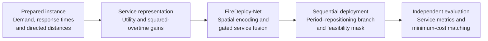

<div align="center">

# FireDeploy-Net

**Deep Reinforcement Learning for Multi-Period Mobile Fire-Unit Deployment**

[](pyproject.toml)
[](requirements.txt)
[](firedeploy/train.py)
[](LICENSE)

</div>

---

This repository provides **FireDeploy-Net**, a deep reinforcement learning method for stationing and repositioning mobile fire units across representative time periods. The method supplements a permanent fire-station network while accounting for time-varying service conditions, a limited number of mobile units and a cumulative repositioning-distance budget.

**Associated manuscript**

*Augmenting Permanent Fire Station Networks through Multi-Period Stationing and Repositioning of Mobile Units: A Deep Reinforcement Learning Approach*

> This repository contains the model, training and inference code. Processed Beijing data and pretrained or fine-tuned weights are not included. A synthetic example is provided to check the implementation.

---

## 1. Overall Workflow



**Main stages**

1. **Data preparation:** provide normalized demand and area weights, fixed-station response times, candidate response matrices and directed repositioning distances.
2. **Service representation:** calculate candidate-level continuous utility gains and squared-overtime reductions relative to the permanent-station baseline.
3. **Training or inference:** construct a deployment for each period through masked sequential candidate selection.
4. **Evaluation:** independently recompute service metrics, match units between consecutive periods and verify the cumulative distance budget.

Road-network preprocessing and demand construction precede the code workflow above. The input specification is given in [docs/data_format.md](docs/data_format.md).

---

## 2. Code Architecture

```text
FireDeploy-Net/
├── firedeploy/
│   ├── encoder.py          Spatial graph-attention encoder
│   ├── model.py            Service fusion and period–repositioning policy
│   ├── environment.py      Service updates and budget-feasibility masks
│   ├── data.py             Input loading, metrics and directed matching
│   ├── rollout.py          Sampling and deterministic decoding
│   ├── train.py            REINFORCE training and checkpoint management
│   ├── infer.py            Deterministic inference entry point
│   └── runtime.py          Runtime setup, evaluation and checkpoint utilities
├── configs/
│   ├── beijing.json        Beijing training configuration
│   └── smoke.json          Synthetic example configuration
├── examples/
│   └── make_synthetic.py   Synthetic instance generator
├── tests/                  Automated correctness checks
├── docs/                   Input and checkpoint specifications
├── licenses/               Third-party license notices
├── requirements.txt
├── pyproject.toml
└── LICENSE
```

The policy, environment and evaluation routines are separated so that candidate selection can be checked against independently recomputed service outcomes and matching costs.

---

## 3. Encoder and Service Representation

The spatial encoder is implemented in [firedeploy/encoder.py](firedeploy/encoder.py), with service-feature fusion in [firedeploy/model.py](firedeploy/model.py).

- **Spatial encoding:** projected candidate coordinates are standardized and embedded using a three-layer, eight-head attention encoder with a 128-dimensional representation.
- **Dual-service gated fusion:** separate branches represent marginal continuous utility improvement and squared-overtime reduction. A learned gate combines the two service representations.
- **Period–repositioning information:** the policy incorporates period context, previous and current deployment representations, and distance-related feasibility information.

During fine-tuning, the period–repositioning branch is added to a pretrained single-period policy. Its output layer is initialized to zero to preserve the pretrained policy scores at initialization.

---

## 4. Decoder and Decision Process

Deployment construction is implemented in [firedeploy/rollout.py](firedeploy/rollout.py) and [firedeploy/environment.py](firedeploy/environment.py).

**Sequential decisions**

1. Score candidate sites using the spatial, service and period–repositioning representations.
2. Mask already selected sites and actions that lack a budget-feasible completion certificate.
3. Select a site and update service gains and the deployment state.
4. Continue until all mobile units have been assigned in each of the three periods.

**Training and inference**

- Training samples actions and uses **REINFORCE with a leave-one-out baseline**.
- Deterministic inference selects the highest-probability legal candidate.
- Exact directed minimum-cost matching evaluates repositioning between consecutive periods.

The feasibility mask supplies a sufficient certificate; it can exclude some feasible actions. The completed deployment is independently checked against the distance budget.

---

## 5. Objective and Beijing Case

The baseline objective combines normalized service-utility improvement and squared-overtime reduction:

$$
F = \frac{1}{2}\frac{U-U_0}{\Delta U}
  + \frac{1}{2}\frac{Q_0-Q}{\Delta Q}.
$$

Here, $U$ is the three-period mean demand-weighted continuous service utility, and $Q$ is the three-period mean area-weighted squared response overtime above 5 minutes. Normalization uses the permanent-station baseline and an all-candidate service reference.

Utility equals 1 up to 5 minutes, decreases continuously between 5 and 20 minutes, and equals 0 from 20 minutes onward. Squared overtime continues to penalize responses beyond 20 minutes.

| Case setting | Value |
|---|---|
| Study area | Within Beijing's Sixth Ring Road |
| Representative periods | Morning peak, midday off-peak, evening peak |
| Existing permanent stations | 310 |
| Mobile units per period | 100 |
| Baseline cumulative repositioning budget | 250.60 km |
| Baseline objective weights | 0.5 for each normalized component |

The full-precision budget and processed-input definitions are documented in [Data format](docs/data_format.md). The current implementation uses three periods and the equal-weight objective above.

---

## 6. Environment and Dependencies

**Requirements:** Python 3.10–3.13 and PyTorch 2.6 or later within the 2.x series. CPU and single-GPU execution are supported.

```bash
git clone https://github.com/HIGISX/FireDeploy-Net.git
cd FireDeploy-Net
python -m venv .venv
```

Activate the environment:

```bash
# Linux / macOS
source .venv/bin/activate
```

```powershell
# Windows PowerShell
.venv\Scripts\Activate.ps1
```

For GPU execution, first install a suitable PyTorch build using the [official installation instructions](https://pytorch.org/get-started/previous-versions/). Then install the package:

```bash
python -m pip install -r requirements.txt
python -m pip install -e .
```

Core dependencies are **PyTorch, NumPy, SciPy, pandas and Numba**.

---

## 7. Data Preparation

An instance is described by an `instance.json` manifest. All referenced paths are resolved relative to that file.

Required inputs include:

- Demand-grid and candidate identifiers with consistent ordering.
- Normalized demand weights for each period and normalized area weights.
- Permanent-station and candidate response times in minutes.
- Candidate coordinates in a common projected coordinate system.
- Directed repositioning distances in kilometres.
- Sparse utility-gain and squared-overtime-reduction matrices.
- Objective normalization constants.

See [docs/data_format.md](docs/data_format.md) for array shapes, gain definitions and a manifest example.

Fine-tuning requires a single-period pretrained policy; inference requires a full FireDeploy-Net checkpoint. These weights and the processed Beijing instance must be supplied separately.

---

## 8. Quick Start

### 8.1 Synthetic example

The example runs without the Beijing dataset or pretrained weights. It creates 12 candidates, 20 demand grids and two units per period, then performs two training updates.

```bash
python examples/make_synthetic.py --output data/synthetic
python -m firedeploy.train --data data/synthetic/instance.json --config configs/smoke.json --output runs/smoke --from-scratch --device cpu --microbatch 2 --threads 1
python -m firedeploy.infer --data data/synthetic/instance.json --checkpoint runs/smoke/best.pt --output runs/smoke/deployment.json --device cpu --threads 1
```

Use a new output directory when repeating the example. Its outputs verify software functionality and do not reproduce the study results.

### 8.2 Fine-tuning

After preparing the Beijing inputs and single-period checkpoint:

```bash
python -m firedeploy.train --data data/beijing/instance.json --config configs/beijing.json --pretrained checkpoints/single_period.pt --output runs/beijing --device cuda --microbatch 8
```

The baseline configuration uses 200 epochs, 50 updates per epoch, an effective batch of 128 complete deployments, Adam with a learning rate of `1e-4`, gradient-norm clipping at 1, and deterministic evaluation every 50 updates. No entropy regularization is used.

The `--microbatch` option controls memory use through sampled-action replay. The leave-one-out baseline is calculated over the complete effective batch. Configurable settings are in [configs/beijing.json](configs/beijing.json).

### 8.3 Deterministic inference

```bash
python -m firedeploy.infer --data data/beijing/instance.json --checkpoint checkpoints/best.pt --output runs/deployment.json --device cuda
```

The output reports selected candidate IDs, per-period service metrics, matched repositioning pairs, cumulative distance and feasibility. Use `--device cpu` for CPU execution.

Initialization, warm-up, decoding and verification times are recorded separately. By default, one warm-up deployment is excluded from `decode_seconds` and included in `total_seconds`.

### 8.4 Resuming training

```bash
python -m firedeploy.train --data data/beijing/instance.json --config configs/beijing.json --resume runs/beijing/latest.pt --output runs/beijing --device cuda --microbatch 8
```

Use the same data, configuration and execution settings. This entry point supports checkpoints generated by the public implementation; original distributed-training checkpoints have a different optimizer and random-state format.

**Training outputs**

| File | Description |
|---|---|
| `latest.pt` | Model, optimizer, random-number states and progress for resuming |
| `best.pt` | Highest evaluated deterministic-objective checkpoint |
| `final.pt` | Model at the end of training |
| `history.json` | Training records and periodic evaluations |
| `summary.json` | Final and best results, update count and elapsed time |

---

## 9. Validation and Reproducibility

Run the automated checks:

```bash
python -m unittest discover -s tests -v
```

Tests cover utility thresholds, reward consistency, directed-distance budget feasibility, policy updates and checkpoint loading. Release validation also exercised the training, resume and inference commands on synthetic data and checked parameter compatibility and forward outputs against the research model on small inputs.

| Environment | Python | PyTorch |
|---|---|---|
| Study training environment | 3.10.20 | 2.6.0 |
| Release validation environment (CPU) | 3.13.13 | 2.9.1 |

This is a portable single-process implementation: service updates and matching run on the CPU, while the policy runs on CPU or GPU. The study's distributed training and optimized GPU environment are not included. Identical training trajectories or reported runtimes are not guaranteed, and a full Beijing experiment was not rerun for release validation.

Support for other input sizes does not by itself establish cross-scale or cross-scenario generalization.

---

## 10. Citation

If you use FireDeploy-Net in research, please cite the accompanying manuscript named above. A formatted citation will be added when publication metadata becomes available.

---

## 11. License and Acknowledgments

This project is released under the [MIT License](LICENSE).

The graph-attention encoder is adapted from [attention-learn-to-route](https://github.com/wouterkool/attention-learn-to-route), retaining its projection parameter layout and using LayerNorm and PyTorch scaled dot-product attention. The original copyright and MIT notice are retained in [licenses/attention-learn-to-route-MIT.txt](licenses/attention-learn-to-route-MIT.txt).
